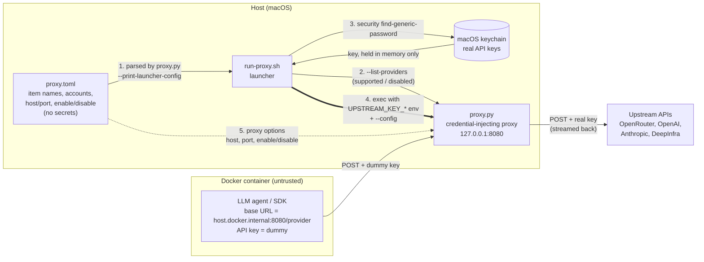
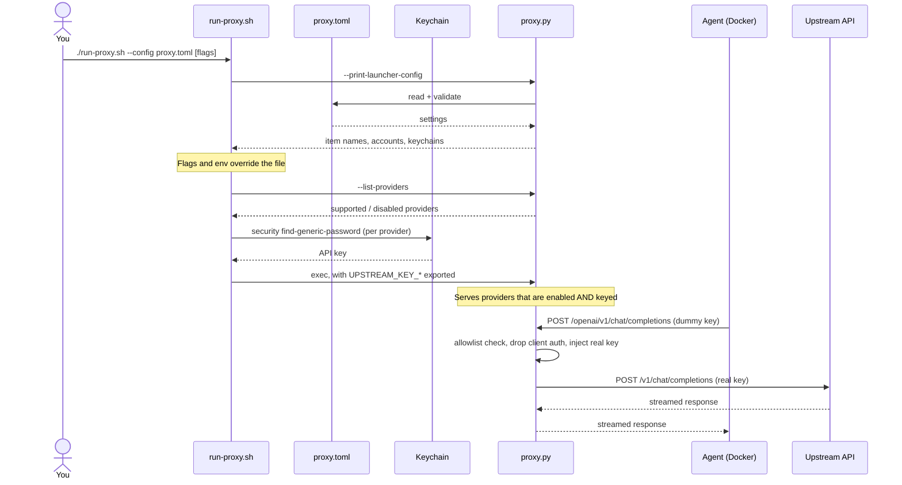

# LLM Credential Proxy

Keep your LLM API keys **away from the AI agent that uses them**.

An agent running in a Docker container talks to a small proxy on the host using a
dummy API key. The proxy injects the real key and forwards the request to the
upstream provider. The real keys live in the macOS keychain and are never written
into the container's environment, filesystem, or mounted secrets, so a
compromised or misbehaving agent has nothing to steal.

Supported providers: **OpenRouter**, **OpenAI**, **Anthropic**, **DeepInfra**
(adding another is a few lines in `proxy.py`).

## Why

Anything inside a container is readable by the agent running there: environment
variables, mounted secret files, `/proc`. If the key is in the container, the agent
(or a prompt-injected tool call) can read and exfiltrate it. With this setup:

- The key exists only on the host: in the keychain, and in the proxy's process
  environment while it runs.
- The proxy forwards **only `POST` to an exact allowlist of paths** per provider
  (everything else returns 403, unknown or disabled providers return 404).
- Client-supplied auth headers are discarded; upstream headers are built from scratch.
- Responses are streamed, so SSE and token streaming work.

## How the pieces fit together

| Component | Role |
|---|---|
| `proxy.toml` | Optional config: proxy options, keychain item names, per-provider settings. **Never contains keys.** |
| `run-proxy.sh` | Host-side launcher. Reads keys from the keychain, exports them as `UPSTREAM_KEY_<PROVIDER>`, then starts `proxy.py`. |
| `proxy.py` | The aiohttp proxy. Also parses and validates the TOML for both programs. |
| macOS keychain | Where the real keys live. |
| Docker container | The agent. Gets a base URL and a dummy key, nothing else. |



Request lifecycle, from launch to a completed call:



## Requirements

- macOS for the keychain launcher (it uses the `security` command). On other
  platforms you can run `proxy.py` directly and supply `UPSTREAM_KEY_*` yourself.
- Python 3 with [`aiohttp`](https://docs.aiohttp.org/).
- Python 3.11+ (or `tomli`) if you use a TOML config file. macOS's system
  `python3` is often 3.9, so use Homebrew, pyenv, or Nix.
- Docker (Docker Desktop on macOS) for the agent.

## Install

### Option 1: Nix (recommended)

Nix provides Python, aiohttp and the wrapper `PATH` for you.

```sh
# Run without installing (from a checkout, or from wherever you host the repo)
nix run . -- --check -c proxy.toml
nix run .#proxy -- --list-providers          # proxy.py alone

# Install into your profile
nix profile install .

# As a flake input (NixOS, nix-darwin, home-manager)
#   inputs.llm-proxy.url = "github:you/llm-proxy";
environment.systemPackages = [ inputs.llm-proxy.packages.${pkgs.system}.default ];
# or with the overlay:
nixpkgs.overlays = [ inputs.llm-proxy.overlays.default ];
home.packages = [ pkgs.llm-credential-proxy ];

# Without flakes
nix-build -E 'with import <nixpkgs> {}; callPackage ./package.nix {}'
```

This installs `run-proxy` (the launcher) and `credential-proxy` (`proxy.py` alone),
plus a sample config at `share/doc/llm-credential-proxy/proxy.toml.example`.
`nix develop` gives a dev shell with Python, aiohttp and shellcheck.

> Flakes only see git-tracked files, so `git add` everything first.

### Option 2: Plain scripts

```sh
git clone <this repo> && cd llm-proxy
python3 -m pip install aiohttp          # add `tomli` on Python < 3.11
chmod +x run-proxy.sh proxy.py
./run-proxy.sh --help
```

`run-proxy.sh` must stay in the same directory as `proxy.py`.

## Quick start

1. **Store each key in the keychain.** The key is prompted for, so it never
   appears on the command line or in shell history:

   ```sh
   security add-generic-password -a "$USER" -s openai-api-key -U -w
   security add-generic-password -a "$USER" -s deepinfra-api-key -U -w
   ```

   Use dedicated, spend-limited keys for each provider.

2. **Check what would run** (reads the keychain, never prints keys):

   ```sh
   ./run-proxy.sh --check -s openai=openai-api-key -s deepinfra=deepinfra-api-key
   ```

3. **Start the proxy:**

   ```sh
   ./run-proxy.sh -v -s openai=openai-api-key -s deepinfra=deepinfra-api-key
   ```

4. **Point the agent at it** (inside the container, with any dummy key):

   | Provider | Base URL |
   |---|---|
   | OpenRouter | `http://host.docker.internal:8080/openrouter/api/v1` |
   | OpenAI | `http://host.docker.internal:8080/openai/v1` |
   | Anthropic | `http://host.docker.internal:8080/anthropic` |
   | DeepInfra | `http://host.docker.internal:8080/deepinfra/v1/openai` |

   ```sh
   docker run --rm -it \
     -e OPENAI_BASE_URL=http://host.docker.internal:8080/openai/v1 \
     -e OPENAI_API_KEY=dummy \
     my-agent-image
   ```

   On Docker Desktop for Mac, `host.docker.internal` reaches the proxy even though
   it listens on `127.0.0.1`. On Linux you will need `--add-host
   host.docker.internal:host-gateway` and a bind address the container can reach
   (see the security notes before changing `--host`).

## Configuration

Everything can be given as flags, environment variables, or a TOML file
(`-c FILE` / `--config FILE` / `PROXY_CONFIG`). **Precedence: flags, then
environment, then the config file, then built-in defaults.** The file never
overrides something you passed explicitly.

```sh
./run-proxy.sh --config proxy.toml
./run-proxy.sh --config proxy.toml -a alice -d openai -- --port 9000
```

A sample is in [`proxy.toml`](proxy.toml):

```toml
[proxy]                        # options for proxy.py
host = "127.0.0.1"
port = 8080
verbose = false
disable = ["deepinfra"]

[keychain]                     # defaults for every provider
account = "alice"
file = "~/Library/Keychains/agent.keychain-db"

[providers.openai]             # per provider
item = "openai-api-key"        # keychain item name (-s openai=...)
account = "bob"                # -a openai=bob
keychain = "login.keychain-db" # -k openai=...
# enabled = false              # skip in the launcher (-d openai)
```

### Launcher (`run-proxy.sh`) options

| Option | Meaning |
|---|---|
| `-c, --config FILE` | TOML config file |
| `-s PROVIDER=ITEM` | Keychain item for a provider (repeatable) |
| `-a [PROVIDER=]ACCOUNT` | Keychain account (default `$USER`) |
| `-k [PROVIDER=]KEYCHAIN` | Keychain file (default: search list) |
| `-d, --disable P` / `-e, --enable P` | Skip / re-enable a provider in the launcher |
| `-n, --dry-run, --check` | Report every provider's status and exit; exit 0 if at least one would run |
| `-l, --list-providers` | List providers `proxy.py` supports |
| `-v, --verbose` | Print the status table and the routes being intercepted |
| `-j, --json` | JSON output for `--check` / `--list-providers` |
| `-- ARGS...` | Pass the rest to `proxy.py` (e.g. `-- --port 9000`) |

Environment: `PROXY_CONFIG`, `KEYCHAIN_SERVICES`, `KEYCHAIN_ACCOUNTS`,
`KEYCHAIN_FILES`, `KEYCHAIN_DISABLE`, `KEYCHAIN_ACCOUNT`, `KEYCHAIN_FILE`,
`PROXY_VERBOSE`. List variables are comma-separated `PROVIDER=value` pairs; a bare
value is the default. See `./run-proxy.sh --help` for the full precedence rules.

### Proxy (`proxy.py`) options

`-H/--host` (`PROXY_HOST`), `-p/--port` (`PROXY_PORT`), `-v/--verbose`,
`--disable P`, `--enable P` (`PROXY_DISABLE` / `PROXY_ENABLE`),
`--list-providers [--json]`, `--dry-run`. Disabling layers as: code, then config,
then env, then flags. Run `python3 proxy.py --help` for details.

### Provider status values

`ok` (will run), `unconfigured` (no keychain item given), `disabled` (launcher),
`proxy_disabled` (disabled in `proxy.py`), `nokey` (item not found or unreadable),
`unknown` (configured but not supported). A provider that cannot run is skipped,
never fatal; the launcher only exits non-zero if none can run.

Handy for scripting:

```sh
./run-proxy.sh --check --json -c proxy.toml | from json | where will_run == false   # nushell
./run-proxy.sh --list-providers --json | jtbl
```

## Security notes and limits

- **The keychain protects keys at rest only.** While running, the key is in the
  proxy's process environment on the host.
- **The proxy has no client authentication.** Anything that can reach its port can
  spend your keys. Keep the default `127.0.0.1` bind; `proxy.py` warns if you bind
  elsewhere.
- **Do not put keys in the TOML file** (it is rejected if you try) or export
  `UPSTREAM_KEY_*` in a shell profile. Config and environment variables hold only
  keychain *item names*. The launcher also unsets any inherited `UPSTREAM_KEY_*`.
- Use **dedicated, spend-limited keys** per provider so a leak is bounded.
- For stronger isolation, run the agent on an internal-only Docker network where the
  proxy is the only egress. This is not built here; a per-provider model allowlist
  and a shared-secret client check are other natural hardening steps.

## Project layout

```
proxy.py        the proxy (and TOML loader / validator)
run-proxy.sh    keychain-aware launcher (bash 3.2 compatible)
proxy.toml      sample configuration
flake.nix       Nix flake: package, apps, overlay, dev shell
package.nix     Nix derivation
```
